# Redazia site template

A news site ready to receive articles from [Redazia](https://redazia.com), the AI newsroom: by hand, when you press **Publish** on an approved draft, or by itself with the **automatic newsroom**. Built with [Astro](https://astro.build), static, fast, no cookies, in one or more languages, with ten ready-made looks.

[Italiano](README.it.md)

| | | |
|---|---|---|
| 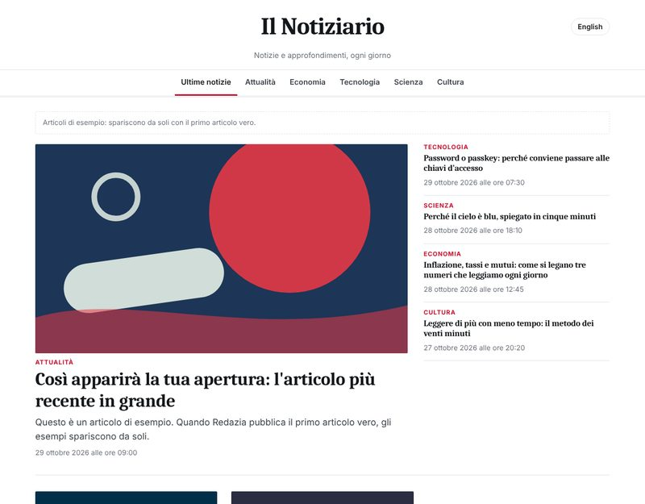 `quotidiano` | 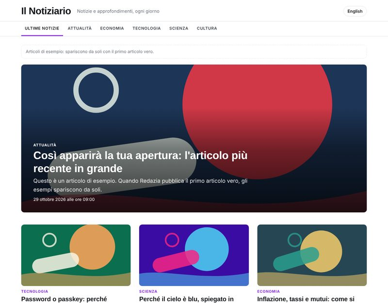 `magazine` | 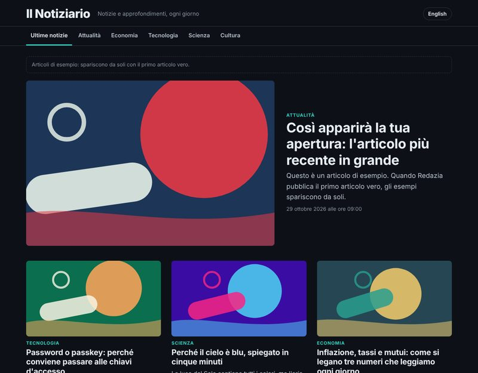 `tech` |
| 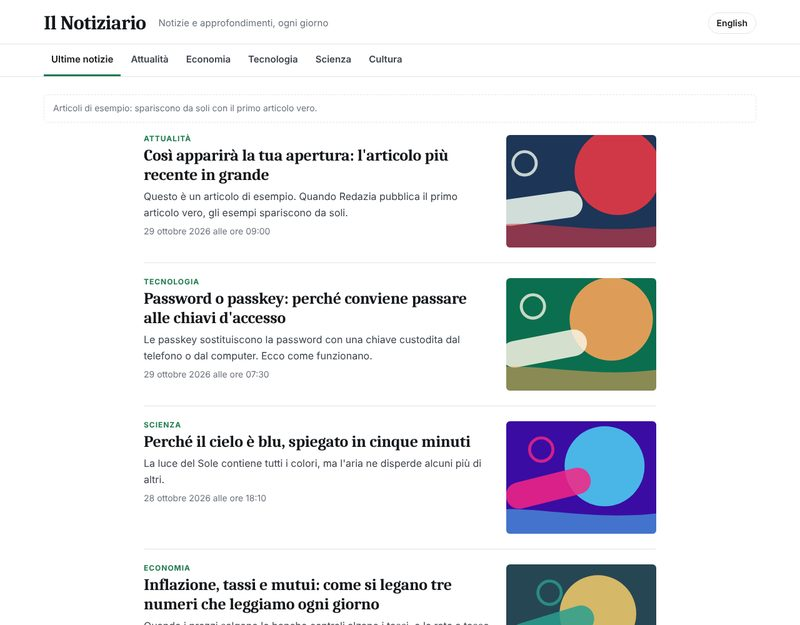 `blog` | 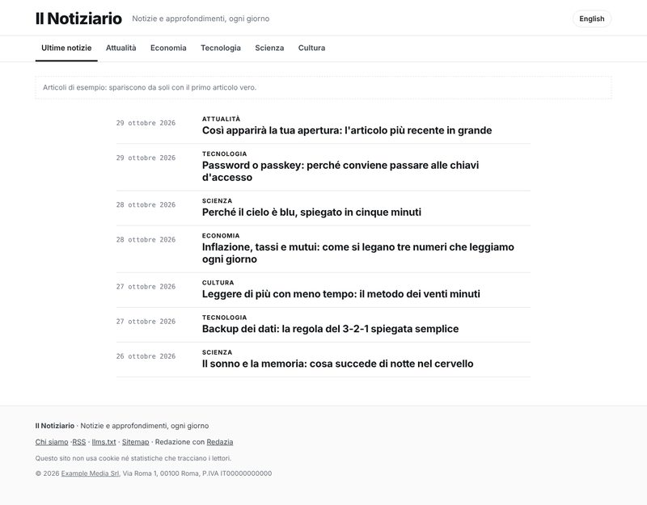 `minimal` | 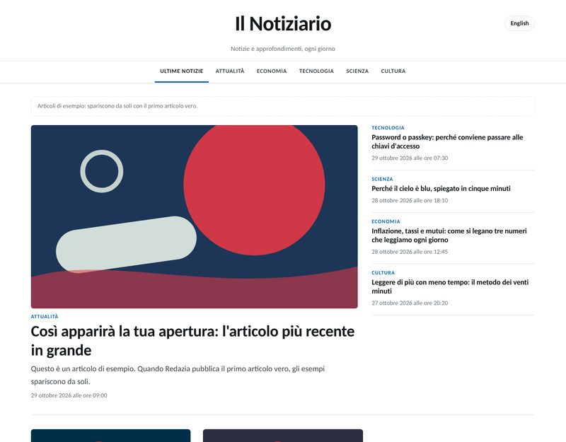 `locale` |
| 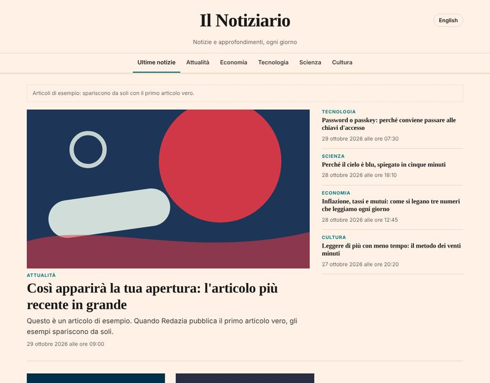 `finanza` | 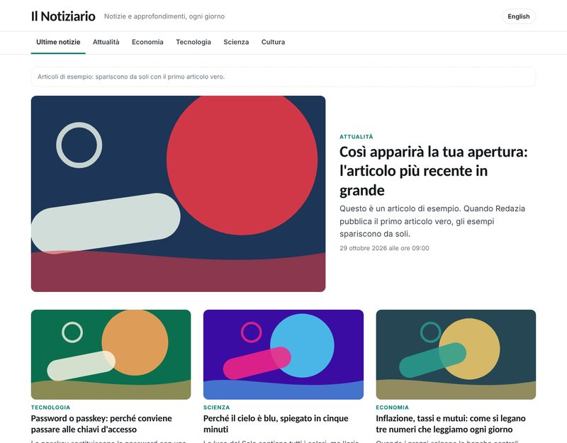 `scienza` | 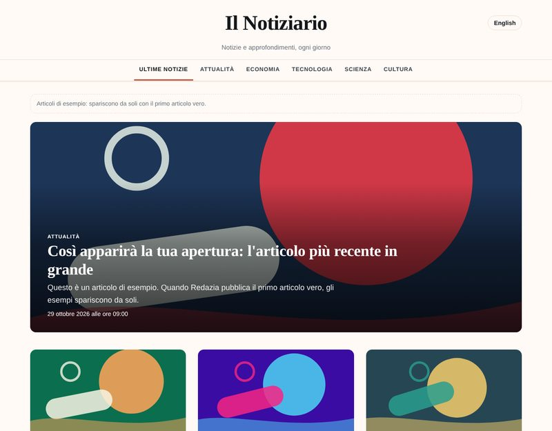 `lifestyle` |
| 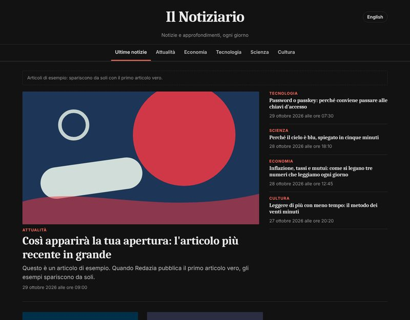 `notte` | 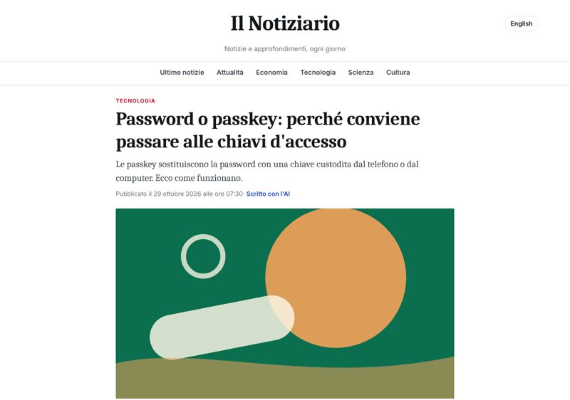 article page | 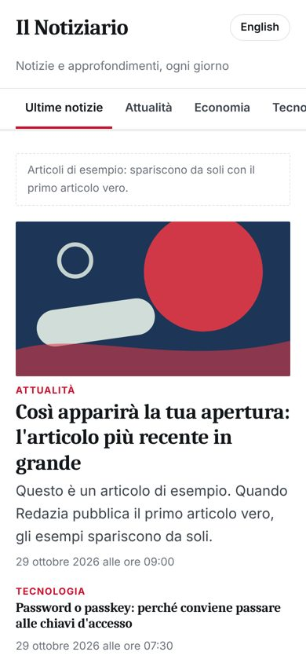 phone |

## What you get

- Home page, one page per section, article pages, "About" with the AI disclosure, 404.
- Up to five languages (Italian, English, German, French, Spanish): the first at `/`, the others under `/en/`, `/de/`…, each with its own feed.
- SEO done: canonical and `hreflang` links, Open Graph, `NewsArticle` structured data, sitemap, RSS, `llms.txt` for AI search engines, `robots.txt`.
- No cookies, no trackers, no fonts from other servers: nothing to ask consent for.
- Every article says how it was written (EU AI Act, art. 50). With `ai: 'automatic'` a banner on every page says the site is run by AI.
- Sample articles until the first real one arrives, so the design shows from day one.

## Start in five minutes

1. Click **Use this template** › **Create a new repository** (it can be private).
2. Edit `site.config.mjs`: name, address, languages, sections, theme, publisher. Commit.
3. Import the repository in [Vercel](https://vercel.com/new) or [Netlify](https://app.netlify.com/start): they detect Astro, nothing to set. Add your domain.
4. Connect it to Redazia (below).

Locally: `npm install`, then `npm run dev` (Node 22.23.4 or newer).

## Connect it to Redazia

Create a fine-grained token on GitHub › Settings › Developer settings › Personal access tokens, for this repository only, with **Contents: read and write**, **Pull requests: read and write** and **Commit statuses: read**.

In Redazia › **Pubblicazioni** add one **GitHub** destination per language:

| Field | Main language (e.g. Italian) | Another language (e.g. English) |
|---|---|---|
| Repository | `you/your-site` | `you/your-site` |
| Articles folder | `src/content/articles/it` | `src/content/articles/en` |
| Articles' address | `https://your-site.com/articoli/{slug}` | `https://your-site.com/en/articles/{slug}` |
| Language | Italian | English |
| Token | the token above | the same token |

The words in the addresses follow `paths` in `site.config.mjs` (defaults: `articoli`, `articles`, `artikel`, `articles`, `articulos`). Covers go to `public/images`.

Each article is one commit, so one deploy. Redazia opens a pull request and merges it only when the Vercel or Netlify preview is green: an article that would break the site never reaches it.

Publish one article by hand and check it on the site before turning on the automatic newsroom.

## Sections

`name` is how Redazia files an article: write the same names in the automatic newsroom's sections (Sito e profilo › Redazione automatica). Each language has its own label and address:

```js
{ name: 'Tecnologia', it: { slug: 'tecnologia', label: 'Tecnologia' }, en: { slug: 'technology', label: 'Technology' } },
```

An article whose section is not in the list still appears on the home page.

## Themes

`theme` in `site.config.mjs`, or the environment variable `SITE_THEME` (in Vercel › Settings › Environment Variables) to try one without a commit. Every theme can be seen live, in five languages, at [demo.redazia.com](https://demo.redazia.com).

`SITE_LANGUAGES` (e.g. `it,en,de`), `SITE_BASE` (e.g. `/news`) and `SITE_URL` change the languages, the folder and the address in the same way. `accent` sets your own colour over any theme.

| Theme | Home | For |
|---|---|---|
| `quotidiano` | lead story, side column, sections | a general newspaper |
| `magazine` | full-width cover, large pictures | magazines |
| `tech` | dark, grid | technology, startups |
| `blog` | one column, picture beside the title | company blogs |
| `minimal` | text only, dates and titles | fast and sober |
| `locale` | newspaper, light colours | local news |
| `finanza` | salmon paper, serif | economy, markets, professions |
| `scienza` | airy grid, cool colours | science, health, environment |
| `lifestyle` | warm, elegant, cover | travel, food, fashion |
| `notte` | the newspaper in dark | evening reading |

## Next to an existing site

Your site cannot receive articles (Squarespace, many site builders)? Keep it, and put this one beside it:

- **Subdomain** `news.your-site.com`: a CNAME record to Vercel or Netlify. The simplest.
- **Folder** `your-site.com/news`: set `base: '/news'` in `site.config.mjs`, then have your main site forward `/news/…` to this site's root (the built files sit at the root, their links start with `/news`) (a rewrite in Cloudflare, Nginx, Apache, Vercel or Netlify). For Google the articles are part of your main site. The articles' address in Redazia becomes `https://your-site.com/news/articoli/{slug}`. Put the sitemap line in your main site's `robots.txt`.

Example for Nginx:

```nginx
location /news/ {
  proxy_pass https://your-news.vercel.app/;   # the trailing slash drops /news
  proxy_set_header Host your-news.vercel.app;
  proxy_ssl_server_name on;
}
```

## Writing articles by hand

Add a Markdown file in `src/content/articles/<language>/`:

```yaml
---
title: "Title"
description: "One or two lines, up to 160 characters"
date: 2026-10-29T08:00:00Z
section: "Tecnologia"
image: "/images/my-picture.webp"
image_alt: "What the picture shows"
---
The text, in Markdown.
```

`draft: true` keeps it off the site.

## License

[MIT](LICENSE): use it, change it, sell sites made with it. Redazia itself is a separate service.
